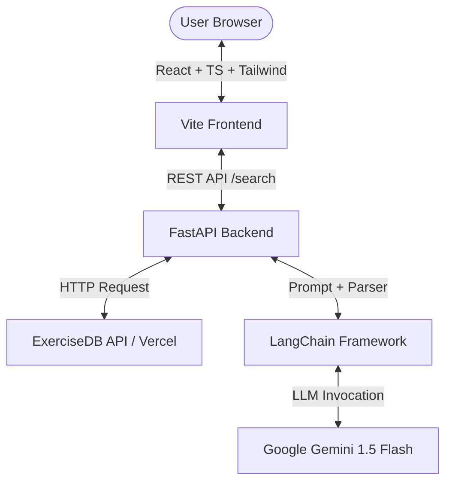

<<<<<<< HEAD
# AI Fitness Assistant – Exercise Recommendation & AI Trainer ⚡

A production-ready full-stack AI Fitness application built with **FastAPI**, **LangChain**, **Google Gemini 1.5 Flash**, **ExerciseDB API**, and **React (Vite + TypeScript + Tailwind CSS)**.

The application allows users to search exercises across multiple categories (Equipment, Muscle, Body Part) using the ExerciseDB API, filters the top 5 exercises, and generates structured AI trainer summaries with actionable form tips, common mistakes, medical precautions, pros/cons, and recommended frequencies.

---

## 🌟 Key Features

- **Multi-Category Exercise Search**: Support for Equipment (`dumbbell`, `barbell`), Muscle (`biceps`, `chest`), and Body Part (`upper arms`, `legs`).
- **AI Trainer Summaries**: Powered by **LangChain** and **Gemini 1.5 Flash**, returning structured JSON output with trainer tone.
- **Modern Glassmorphism UI**: Built with React, TypeScript, and Tailwind CSS.
- **Copy & PDF Export**: One-click summary copying to clipboard and downloadable PDF reports via `jsPDF`.
- **Search History & Favorites**: Local persistence for quick reference of previous searches and bookmarked exercises.
- **Fallback High Availability**: Intelligent offline/rate-limit fallback summarization engine ensuring zero downtime.
- **Skeleton Loaders & Animations**: Smooth micro-interactions and celebratory celebratory feedback on search.
- **API Swagger Documentation**: Auto-generated interactive documentation at `/docs`.

---

## 🏗️ Architecture Overview



---

## 📁 Project Folder Structure

```
fitness-ai/
├── backend/
│   ├── app.py           # Main FastAPI application entry point
│   ├── routes.py        # API Endpoints (GET /, POST /search)
│   ├── llm.py           # LangChain + Gemini 1.5 Flash setup & fallback engine
│   ├── prompts.py       # LangChain Prompt Templates
│   ├── models.py        # Pydantic data schemas
│   ├── services.py      # ExerciseDB client & parallel processing
│   ├── requirements.txt # Python dependencies
│   └── .env             # Backend environment variables
│
├── frontend/
│   ├── src/
│   │   ├── components/  # Header, SearchCard, ExerciseCard, SkeletonCard, etc.
│   │   ├── types/       # TypeScript interfaces
│   │   ├── api.ts       # Axios client for FastAPI
│   │   ├── App.tsx      # Main Dashboard layout
│   │   └── main.tsx     # React DOM entry
│   ├── package.json
│   └── tailwind.config.js
│
└── README.md
```

---

## 🔑 Environment Variables

### Backend (`backend/.env`)

```env
GEMINI_API_KEY=your_gemini_api_key_here
EXERCISE_API_BASE=https://exercisedb-api.vercel.app/api/v1
```

---

## 🚀 How to Run Locally

### Prerequisites
- **Python**: 3.11 or higher
- **Node.js**: v18 or higher
- **npm** or **yarn**

---

### Step 1: Backend Setup (FastAPI)

1. Open terminal and navigate to `backend/`:
   ```bash
   cd backend
   ```

2. Create and activate a virtual environment:
   ```bash
   python -m venv venv
   source venv/bin/activate  # On Windows: venv\Scripts\activate
   ```

3. Install required Python packages:
   ```bash
   pip install -r requirements.txt
   ```

4. Create `.env` file and set your `GEMINI_API_KEY`:
   ```bash
   cp .env.example .env
   ```

5. Start the FastAPI development server:
   ```bash
   python app.py
   # OR: uvicorn app:app --reload --port 8000
   ```
   The backend will be available at `http://localhost:8000`. Access Swagger UI docs at `http://localhost:8000/docs`.

---

### Step 2: Frontend Setup (React + Vite + TypeScript)

1. Open a new terminal tab and navigate to `frontend/`:
   ```bash
   cd frontend
   ```

2. Install Node dependencies:
   ```bash
   npm install
   ```

3. Start the Vite development server:
   ```bash
   npm run dev
   ```
   Open your browser at `http://localhost:3000`.

---

## 📡 API Reference

### Health Check
- **GET** `/`
- **Response**:
  ```json
  { "message": "API Running" }
  ```

### Exercise Search & AI Recommendation
- **POST** `/search`
- **Request Body**:
  ```json
  {
    "search_type": "equipment",
    "keyword": "dumbbell"
  }
  ```
- **Response**: Array of top 5 exercises enriched with `summary` JSON object.

---

## 🌐 Deployment Instructions

### Deploy Backend to Render

1. Create a new **Web Service** on [Render](https://render.com).
2. Connect your GitHub repository.
3. Set **Root Directory** to `backend`.
4. Build Command:
   ```bash
   pip install -r requirements.txt
   ```
5. Start Command:
   ```bash
   gunicorn -w 4 -k uvicorn.workers.UvicornWorker app:app
   ```
6. Add Environment Variables:
   - `GEMINI_API_KEY`: Your Gemini API key.
   - `EXERCISE_API_BASE`: `https://exercisedb-api.vercel.app/api/v1`

---

### Deploy Frontend to Vercel

1. Import your GitHub repository into [Vercel](https://vercel.com).
2. Set **Root Directory** to `frontend`.
3. Framework Preset: **Vite**.
4. Build Command: `npm run build`.
5. Output Directory: `dist`.
6. Add Environment Variable:
   - `VITE_API_BASE_URL`: Your deployed Render backend URL (e.g. `https://your-app.onrender.com`).

---

## 🔮 Future Improvements

- [ ] User authentication with Firebase / Auth0 for cloud sync of saved exercises.
- [ ] Integration with wearable health devices (Apple HealthKit / Google Fit).
- [ ] Video playback support for exercise technique demos.
- [ ] Custom workout routine builder using saved favorite exercises.
=======
# AI-Fitness
>>>>>>> 7a3afd2cc0c6841690896617e0bd4d3d6b973fc5
